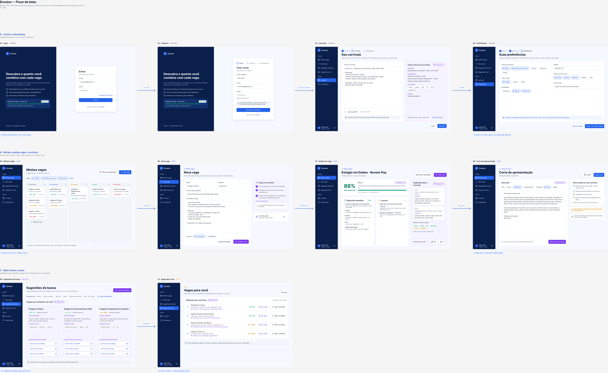

# Projeto3_tecweb

- **Deploy:** https://encaixe-yg09.onrender.com
- **API:** https://encaixe-backend.onrender.com/api

> Backend no plano gratuito do Render: depois de 15 min sem uso ele "dorme", e o primeiro acesso pode levar até 1 minuto.

## Descrição e proposta de valor

O Encaixe é um assistente de candidatura para quem procura estágio, trainee ou primeira vaga júnior. O usuário cadastra o currículo uma vez (em PDF ou colando o texto) e, para cada vaga que encontra, cola a descrição e recebe:

1. uma nota de aderência (0 a 100) do currículo à vaga, com os requisitos que ele atende, as lacunas, sugestões do que fazer e alertas quando a vaga vai contra as preferências dele (modalidade, cidade, tipo de vaga);

2. uma carta de apresentação escrita só com fatos do currículo, listando os fatos usados para ele conferir;

3. um quadro de candidaturas para acompanhar cada vaga (interessado → candidatado → entrevista → oferta → encerrada).

Além disso, o Encaixe sugere cargos e palavras-chave de busca a partir do currículo, monta links prontos para LinkedIn, Indeed e Gupy, e lista vagas reais (API do Adzuna) ranqueadas pela IA.

A proposta de valor: trocar o "mandar currículo para tudo" por candidaturas escolhidas. Em poucos segundos o usuário sabe se vale a pena se candidatar, o que falta no currículo para aquela vaga e sai com uma carta honesta pronta para editar, tudo organizado num só lugar.

## Público-alvo

Estudantes universitários e recém-formados procurando o primeiro estágio, trainee ou vaga júnior, principalmente quem se candidata a muitas vagas ao mesmo tempo e ainda não tem experiência para avaliar sozinho se o próprio perfil "encaixa" no que a vaga pede.

## Contribuição de cada integrante

Integrante:	Rodrigo Buniac	
Principais contribuições: Deploy no Render (backend, frontend e PostgreSQL); seções de descrição, público-alvo e problema deste README;

Integrante: Felipe Menusier
Principais contribuições:

Integrante: Felipe Aldrighi
Principais contribuições:

Integrante: Theo Casagrande
Principais contribuições:


## Uso de IA no desenvolvimento


## Problema que o projeto resolve

Quem procura a primeira vaga costuma não saber se vale a pena se candidatar, gasta tempo demais escrevendo cartas para cada vaga, perde o controle de onde já se candidatou e não sabe quais cargos e palavras-chave buscar.

O Encaixe resolve isso com a análise vaga × currículo, a carta baseada só em fatos, o quadro de candidaturas e as sugestões de busca.

## Cronograma

Legenda de tamanho: XS, S, M, L, XL (os mesmos usados no quadro do GitHub Projects).
Níveis do produto: **Núcleo** (análise vaga × currículo), **Meio-termo** (preferências e sugestões de busca) e **Extra** (vagas reais via API pública).

### Sprint 1 (10/11 a 13/11): fluxo principal funcionando de ponta a ponta

**Setup e entregáveis do enunciado**
- [X] Validar a proposta com a Bárbara (XS)
- [X] Criar o repositório e adicionar a `BarbaraTieko` (XS)
- [X] Criar o quadro "Team Planning" no GitHub Projects com To Do, Doing e Done; cada tarefa com responsável, tamanho, data de início e data de fim (S)
- [X] Desenhar o fluxo de telas de baixa fidelidade e salvar a imagem em `docs/` (M)
- [X] Criar o esqueleto do Django REST Framework e do React (Vite), com `.env.example` e CORS (S)
- [X] Escolher e configurar o framework CSS: Tailwind (S)
- [X] Fazer o deploy inicial (backend e frontend) e colocar o link no README (M)
- [X] Gerar a chave da API do Gemini e guardá-la em variável de ambiente (XS)

**Conta de usuário**
- [X] Endpoints de cadastro, login e logout (M)
- [X] Telas de cadastro e login, com rotas protegidas no React (M)

**Núcleo: currículo, vagas e análise**
- [X] Criar os modelos `Perfil`, `Curriculo`, `Vaga` e `Analise` (S)
- [X] API de CRUD de vagas, com status (interessado, candidatado, entrevista, oferta, encerrada) (M)
- [X] Tela para o usuário colar o texto do currículo (M)
- [X] IA: estruturar o currículo em JSON e guardar em cache (M)
- [X] IA: endpoint de análise da vaga com prompt, schema de saída e validação no serializer (L)
- [X] Cache da análise por par (currículo, vaga) (S)
- [X] Tela de nova vaga (colar o texto) e tela de resultado da análise (L)
- [X] Kanban básico de vagas: listar por status e mover entre colunas (M)
- [X] Deploy com o fluxo principal funcionando (S)
- [X] Responder o questionário de equipe da Sprint 1 (XS)

### Sprint 2 (16/11 a 19/11): acabamento, meio-termo e diferencial

**Núcleo: finalização**
- [X] IA: gerar carta de apresentação usando só fatos do currículo, com edição pelo usuário (M)
- [X] Tratar erros da IA (limite de requisições, JSON inválido, tempo esgotado) e estados de carregamento (M)
- [X] Aviso de privacidade sobre o envio do currículo à API de IA (XS)
- [X] Envio do currículo em PDF: o backend extrai o texto e o usuário confere antes de salvar (S)
- [X] Aplicar o framework CSS em todas as telas (L)
- [X] Testes do backend: autenticação, vagas e análise com a IA simulada (mock) (M)

**Meio-termo: preferências e sugestões**
- [X] Modelo e endpoint de preferências (áreas, tipo da vaga, modalidade, cidade, stack, o que evitar) (S)
- [X] Tela de preferências no perfil (M)
- [X] Usar as preferências no prompt da análise e da carta (S)
- [X] Filtro do kanban pelas preferências (S)
- [X] IA: sugerir áreas, cargos e palavras-chave de busca a partir do currículo e das preferências (M)
- [X] Gerar links de busca prontos com essas palavras-chave (S)

**Extra (só se sobrar tempo; é o primeiro item a cortar)**
- [X] Verificar cobertura para o Brasil e limites gratuitos de uma API pública de vagas (S)
- [X] Integrar a API e listar vagas reais (L)
- [X] IA: ranquear as vagas pela aderência ao perfil (M)
- [X] Botão "salvar no kanban" nas vagas listadas (S)

**Diferencial (A+)**
- [X] Montar um conjunto com cerca de 10 pares currículo × vaga (M)
- [ ] Comparar duas versões do prompt nesse conjunto e registrar o resultado no README (M): comando pronto, falta rodar com a chave do Gemini
- [ ] Teste rápido com cerca de 5 usuários e registro do retorno no README (M)
- [ ] Responder o questionário de equipe da Sprint 2 (XS)

### Fechamento (20/11 a 23/11)
- [ ] Congelar funcionalidades em 20/11 (XS)
- [X] README completo: proposta, público-alvo, como rodar backend e frontend, variáveis de ambiente, link do deploy, fluxo de telas e uso de IA (M)
- [] Revisar o quadro: todas as tarefas com responsável, tamanho, datas e passagem por To Do, Doing e Done (S)
- [X] Conferir que todos os integrantes têm commits significativos (XS)
- [ ] Testar o deploy do zero com uma conta nova (S)
- [ ] Preparar a apresentação, incluindo o exemplo concreto de uso de IA no desenvolvimento: o que queríamos, como usamos a IA, o que corrigimos e como verificamos (M)
- [ ] Ensaiar a apresentação (S)
- [ ] Último commit antes das 09:30 de 24/11 (XS)

### Apresentação: 24/11/2026

## Estrutura do repositório

```
backend/    Django REST Framework (projeto "encaixe")
  contas/   Perfil, Preferencias, cadastro, login e logout
  vagas/    Curriculo, Vaga, Analise, Carta, Sugestoes, o CRUD de vagas e a IA (ia.py)
            compatibilidade.py (filtro do kanban) e busca.py (links do LinkedIn, Gupy e Indeed)
            pdf.py (texto do currículo em PDF), vagas_reais.py (API do Adzuna)
            e management/commands/comparar_prompts.py
  build.sh  build do deploy no Render
frontend/   React (Vite) + Tailwind
  src/api.js            axios já com o endereço do backend e o token
  src/vagas.js          status do kanban, nível da nota e datas
  src/preferencias.js   opções e textos das preferências (tela, filtro e sugestões)
  src/auth/             login no React (useAuth, RotaProtegida)
  src/components/       Layout, formulário, cabeçalho, aviso de privacidade, carregamento da IA...
  src/pages/            uma tela por arquivo
docs/       fluxo de telas, avaliacao/ (pares currículo × vaga e resultado da comparação) e roteiro do teste com usuários
```

## Fluxo de telas



Telas prontas: login, cadastro, currículo (envio do PDF ou texto colado), preferências, minhas vagas (kanban com filtro por preferências), nova vaga, análise da vaga, carta de apresentação, sugestões de busca e vagas para você (vagas reais ranqueadas pela IA).

## Como rodar localmente

Precisa de Python 3.11+ e Node.js 20+. Rode o backend e o frontend em dois terminais.

**Backend** (http://127.0.0.1:8000)

```bash
cd backend
python -m venv .venv
.venv\Scripts\activate          # Windows (no Mac/Linux: source .venv/bin/activate)
pip install -r requirements.txt
copy .env.example .env          # Mac/Linux: cp .env.example .env  (depois preencha o .env)
python manage.py migrate
python manage.py createsuperuser   # opcional, para usar o /admin
python manage.py runserver
```

**Frontend** (http://localhost:5173)

```bash
cd frontend
npm install
npm run dev
```

O frontend chama `http://127.0.0.1:8000/api` por padrão. Para mudar, crie `frontend/.env` a partir do `frontend/.env.example`.

## Variáveis de ambiente

Os valores ficam em `backend/.env` (local) ou no painel do Render (deploy). O `.env` nunca vai para o Git.

| Variável | Para que serve |
| --- | --- |
| `SECRET_KEY` | chave secreta do Django |
| `DEBUG` | `True` só na máquina local |
| `ALLOWED_HOSTS` | domínios aceitos, separados por vírgula |
| `CORS_ALLOWED_ORIGINS` | endereços do frontend que podem chamar a API |
| `DATABASE_URL` | PostgreSQL do Render (vazio = SQLite local) |
| `GEMINI_API_KEY` | chave da API do Gemini (Google AI Studio) |
| `GEMINI_MODEL` | (opcional) modelo do Gemini; padrão `gemini-3.5-flash-lite` |
| `ADZUNA_APP_ID` / `ADZUNA_APP_KEY` | (opcional) credenciais grátis da API de vagas do [Adzuna](https://developer.adzuna.com); sem elas, "Vagas para você" avisa que não está configurada |
| `VITE_API_URL` | (frontend) endereço da API, terminando em `/api` |

## API

Todas as rotas, menos cadastro e login, exigem o cabeçalho `Authorization: Token <token>`. No React, use o `api` de `src/api.js`, que já manda o token.

| Método | Rota | O que faz | Resposta |
| --- | --- | --- | --- |
| POST | `/api/auth/cadastro/` | cria conta: `{nome, email, senha}` | 201 `{token, usuario}` |
| POST | `/api/auth/login/` | entra: `{email, senha}` | 200 `{token, usuario}` |
| POST | `/api/auth/logout/` | invalida o token | 204 |
| GET | `/api/auth/eu/` | usuário logado | 200 `{id, nome, email}` |
| GET | `/api/vagas/` | lista as vagas do usuário (filtro opcional `?status=entrevista`) | 200 |
| POST | `/api/vagas/` | cria vaga: `{titulo, empresa, descricao, local?, link?, status?}` | 201 |
| GET | `/api/vagas/<id>/` | detalhe da vaga | 200 |
| PUT / PATCH | `/api/vagas/<id>/` | edita a vaga (PATCH `{status}` move no kanban) | 200 |
| DELETE | `/api/vagas/<id>/` | apaga a vaga | 204 |

Status da vaga: `interessado`, `candidatado`, `entrevista`, `oferta`, `encerrada`. Cada vaga traz `ultima_nota` (0 a 100, ou `null` se ainda não foi analisada) e `fora_das_preferencias` (ver [Preferências](#preferências-e-sugestões-de-busca)). Erros de validação voltam com 400 no formato `{campo: ["mensagem"]}`; vaga de outro usuário responde 404.

### Currículo e análise com IA

| Método | Rota | O que faz | Resposta |
| --- | --- | --- | --- |
| GET | `/api/curriculo/` | currículo do usuário | 200 `{texto, dados, desatualizado, atualizado_em}` ou 404 |
| PUT | `/api/curriculo/` | salva `{texto}` (mín. 50 caracteres) e a IA estrutura em `dados` | 200 |
| POST | `/api/curriculo/pdf/` | lê o texto de um PDF enviado (multipart `arquivo`), sem salvar | 200 `{texto, paginas, cortado}` ou 400 `{detail, codigo}` |
| POST | `/api/vagas/<id>/analise/` | analisa a vaga com a IA | 201 (nova) ou 200 (do cache) |
| GET | `/api/vagas/<id>/analise/` | última análise da vaga | 200 ou 404 |

**Currículo em PDF:** a tela do currículo aceita o arquivo (botão ou arrastar e soltar) e chama `POST /api/curriculo/pdf/`. O `vagas/pdf.py` lê o texto com o [pypdf](https://pypdf.readthedocs.io) e devolve para a tela: nada é salvo até o usuário conferir o texto e clicar em Salvar currículo (o PUT normal). Limites: 5 MB, 10 páginas e 20 mil caracteres (`cortado: true` avisa que o resto ficou de fora). Não tem OCR, então PDF escaneado (só imagem) responde 400 com `codigo: sem_texto` e a tela pede para colar o texto. Os outros códigos são `tipo` (não é .pdf), `grande`, `protegido` (PDF com senha), `invalido` (arquivo corrompido) e `sem_arquivo`.

A análise volta como `{id, vaga, nota, resultado, desatualizada, modelo_ia, versao_prompt, criado_em}`, com `resultado = {nota, resumo, requisitos_atendidos[], lacunas[], sugestoes[], alertas_preferencias[]}`. O JSON da IA é validado pelo `ResultadoAnaliseSerializer` antes de ser salvo.

Cache: o currículo só é reestruturado quando o texto muda, e a análise só chama a IA de novo quando o currículo, o cargo/empresa/descrição da vaga ou as preferências mudam (chave = hashes SHA-256). Falha da IA (sem chave, limite de requisições, tempo esgotado, JSON fora do formato) responde 502 com `{detail, codigo}` (ver [Erros da IA](#erros-da-ia)). POST de análise sem currículo cadastrado responde 400.

### Carta de apresentação

| Método | Rota | O que faz | Resposta |
| --- | --- | --- | --- |
| GET | `/api/vagas/<id>/carta/` | carta salva da vaga | 200 ou 404 |
| POST | `/api/vagas/<id>/carta/` | a IA escreve uma versão nova: `{tom?, tamanho?}` | 201 |
| PATCH | `/api/vagas/<id>/carta/` | salva a edição do usuário: `{texto}` (até 6000 caracteres) | 200 |

`tom`: `formal`, `neutro` (padrão) ou `entusiasmado`. `tamanho`: `curta` (padrão) ou `media`. A resposta é `{id, vaga, texto, fatos_usados[], tom, tamanho, editada, desatualizada, modelo_ia, versao_prompt, criado_em, atualizado_em}`. O prompt manda a IA usar só fatos do currículo estruturado e devolver em `fatos_usados` os fatos que ela usou, para o usuário conferir; se a vaga já foi analisada, as lacunas da análise entram no prompt para a carta tratar com honestidade o que falta. A carta não tem cache: cada POST é uma versão nova (substitui a anterior, inclusive as edições). `editada` = o usuário mudou o texto da IA; `desatualizada` = o currículo ou a vaga mudaram depois que a carta foi gerada (a análise tem o mesmo campo).

### Preferências e sugestões de busca

| Método | Rota | O que faz | Resposta |
| --- | --- | --- | --- |
| GET | `/api/preferencias/` | preferências do usuário (tudo vazio e `atualizado_em: null` se nunca salvou) | 200 |
| PUT | `/api/preferencias/` | salva `{areas[], tipos[], modalidades[], cidade, stack[], evitar}` | 200 |
| GET | `/api/sugestoes/` | últimas sugestões de busca | 200 ou 404 |
| POST | `/api/sugestoes/` | a IA sugere cargos novos (substitui os anteriores) | 201 |

`tipos`: `estagio`, `trainee`, `junior`. `modalidades`: `presencial`, `hibrido`, `remoto`. `areas` (até 10) e `stack` (até 15) são textos livres de até 40 caracteres; repetidos e vazios são ignorados.

Onde as preferências entram:

- **Análise (prompt v2):** a IA recebe as preferências e devolve `alertas_preferencias`, os pontos da vaga que vão contra elas (ex.: "Você prefere vagas remotas, e esta é presencial em Campinas."). A nota não muda: ela mede só o currículo contra a vaga. Mudar as preferências deixa a análise `desatualizada`.
- **Carta (prompt carta-v2):** só as áreas e a stack de interesse entram, como motivação; o prompt proíbe tratá-las como experiência. Cidade, modalidade e "prefiro evitar" ficam fora da carta.
- **Kanban:** cada vaga traz `fora_das_preferencias`, a lista do que nela contraria o tipo, a modalidade ou a cidade (ex.: `["Júnior", "Presencial", "Fora de São Paulo"]`). É uma busca por palavras no cargo, no local e na descrição (`vagas/compatibilidade.py`), sem IA: roda em todas as vagas, na hora e sem gastar cota. Só conta como conflito o que a vaga diz claramente; vaga que não informa continua aparecendo no filtro.
- **Sugestões de busca:** cada cargo vem como `{cargo, area, nota, por_que, busca, palavras_chave[], links[]}`. `nota` é a aderência estimada do currículo às vagas típicas do cargo; `busca` é o texto para digitar nos sites. Os `links` (LinkedIn, Gupy e Indeed) são montados pelo backend a cada leitura (`vagas/busca.py`), com a cidade, a modalidade e o nível das preferências atuais, então mudar as preferências já muda os links, sem chamar a IA. O Encaixe só monta a URL: nada desses sites é lido pelo backend.

### Vagas para você (extra)

| Método | Rota | O que faz | Resposta |
| --- | --- | --- | --- |
| GET | `/api/vagas-reais/?q=estágio dados` | busca vagas reais do Brasil no Adzuna e a IA ranqueia pelo currículo | 200 `{termo, cidade, vagas[], ranqueada, erro_ranking}` |

Sem `q`, o termo é o `busca` da melhor sugestão de busca ou, sem sugestões, o tipo + a primeira área das preferências (ex.: "estágio Dados"); sem nenhum dos dois, 400. A cidade vem das preferências, com a mesma regra dos links de busca (quem só quer remoto não filtra cidade e a busca ganha "remoto").

Cada vaga vem no formato do modelo `Vaga` (`titulo, empresa, local, descricao, link`), então o botão "Salvar no kanban" só manda esses campos para `POST /api/vagas/`. Também vêm `id` (do Adzuna), `criado_em`, `fora_das_preferencias` (o mesmo filtro do kanban), `salva_id` (id da vaga no kanban se o link já foi salvo, senão `null`) e `nota`/`motivo` do ranking.

Ranking (prompt `ranking-v1`): uma chamada ao Gemini para a lista inteira, que devolve `{id, nota, motivo}` por vaga, validada pelo `ResultadoRankingSerializer`. Ids que a IA inventa são ignorados e vaga sem nota vai para o fim. Sem currículo, a lista volta sem notas. Se a IA falhar, a lista volta mesmo assim, com `ranqueada: false` e a mensagem em `erro_ranking`. Falha do Adzuna responde 502 `{detail, codigo}` (`sem_chave`, `limite`, `indisponivel`, `sem_conexao`), como os erros da IA.

**Por que o Adzuna** (verificado em 17/11/2026 em developer.adzuna.com):

- Cobre o Brasil: `api.adzuna.com/v1/api/jobs/br/search/1` (o site é o adzuna.com.br). Gupy, LinkedIn e Indeed não têm API pública de busca.
- Grátis: a chave sai na hora, sem cartão. Os termos dizem que o plano grátis é "para avaliar a API" e que os limites aparecem no painel da conta (não há números públicos). Uso acadêmico e busca pessoal são permitidos; uso comercial exige contrato.
- Limitações: a API devolve só um **trecho** da descrição, então a tela pede para abrir o anúncio e colar a descrição completa antes da análise. Cada vaga mostrada precisa do crédito "Adzuna" com link (está no rodapé da lista).
- Cada busca gasta 1 chamada do Adzuna e 1 do Gemini (sem cache).

### Erros da IA

Toda falha da IA responde 502 com `{detail, codigo}`. O `detail` já é a mensagem para mostrar ao usuário; o `codigo` diz o tipo:

| `codigo` | Quando acontece | O backend tenta de novo? |
| --- | --- | --- |
| `limite` | o Gemini respondeu 429 (cota gratuita acabou) | não |
| `tempo_esgotado` | o Gemini passou de 50 s sem responder | não |
| `indisponivel` | o Gemini respondeu 5xx | sim, uma vez |
| `formato_invalido` | JSON quebrado ou fora do schema (o serializer reprova) | sim, uma vez, no JSON quebrado |
| `sem_conexao` | sem rede até o Google | não |
| `recusado` | 400/401/403: em geral, chave inválida | não |
| `sem_chave` | `GEMINI_API_KEY` vazia no backend | não |

No frontend, as chamadas à IA usam `{ timeout: TEMPO_IA }` (2 min) e as telas mostram um card de carregamento com contador de segundos e o botão "Tentar de novo" quando dá erro.

O código da IA fica em `backend/vagas/ia.py` (chamada REST ao Gemini, prompts e schemas).

## Avaliação dos prompts (diferencial)

**Conjunto:** `docs/avaliacao/pares.json` tem 11 pares currículo × vaga fictícios (4 currículos: dados, administração, dev full-stack e design). Cada par tem uma `nota_referencia`, a nota que esperamos de um recrutador: casos de aderência alta, média e baixa, incluindo vagas de outra área e vagas que pedem experiência que o currículo não tem. **Revisem as notas de referência antes de rodar**: elas são o gabarito.

**O que comparamos:** o prompt da análise em produção (`v2`) contra uma `v3` que dá uma escala explícita para a nota (separa requisitos obrigatórios de desejáveis, com faixas 85–100 / 65–84 / 40–64 / 0–39) e pede a evidência do currículo em cada requisito atendido. As duas ficam em `INSTRUCAO_NOTA` no `vagas/ia.py`.

**Como rodar** (usa a chave de verdade: 11 pares × 2 versões × 2 rodadas = 44 chamadas, com 4 s de pausa entre elas):

```bash
cd backend
python manage.py comparar_prompts            # opções: --rodadas 1, --pausa 6, --versoes v2 v3
```

O comando escreve `docs/avaliacao/resultado.md` com três métricas por versão: **erro médio** (distância da nota da IA até a referência), **faixa certa** (alta/média/baixa iguais às do frontend) e **variação entre rodadas** (a mesma entrada dá a mesma nota?).

**Resultado:** _rodar o comando e colar aqui a tabela-resumo do `resultado.md`, com a decisão (manter a v2 ou trocar `VERSAO_PROMPT` para `"v3"`). O cache da análise não olha a versão do prompt: análises antigas continuam na v2 até o currículo, a vaga ou as preferências mudarem._

## Teste com usuários (diferencial)

Roteiro em `docs/teste-usuarios.md` (5 tarefas, cerca de 15 min por pessoa). Registrar aqui o retorno das ~5 pessoas: quem testou (curso/semestre), onde travou e o que mudamos por causa disso.

## Testes

```bash
cd backend
python manage.py test
```

São 87 testes, todos com a IA simulada (mock), sem gastar a cota do Gemini: cadastro, login, logout e token (`contas/tests.py`); CRUD de vagas, status do kanban e acesso só às próprias vagas; currículo, análise e carta com cache e validação; e a tradução de cada falha do Gemini (429, 5xx, tempo esgotado, JSON inválido, sem chave) em `ErroIA` (`vagas/tests.py`). As preferências estão em `contas/tests_preferencias.py`. O filtro do kanban, os links de busca, o que vai em cada prompt, o cache da análise com preferências e as sugestões de busca estão em `vagas/tests_meio_termo.py`. As vagas reais (Adzuna simulado), o ranking, o "salvar no kanban" e o comando `comparar_prompts` estão em `vagas/tests_extra.py`. O envio do currículo em PDF está em `vagas/tests_pdf.py`, com PDFs montados byte a byte pelo próprio teste (nenhum arquivo de exemplo no repositório).

Cuidado ao escrever testes: o `@patch` de uma classe não vale dentro do `setUp`. Se o `setUp` salva o currículo, simule a IA ali também; senão o teste chama o Gemini de verdade.

## Deploy (Render)

Feito em 17/11/2026: backend (Web Service), frontend (Static Site) e PostgreSQL no Render, região Oregon. Passo a passo:

1. **Banco**: crie um PostgreSQL (plano free) e copie a *External Database URL*.
2. **Backend**: crie um *Web Service* ligado a este repositório.
   - Root Directory: `backend` · Runtime: Python
   - Build Command: `bash build.sh` (instala, roda o `collectstatic` e o `migrate`)
   - Start Command: `gunicorn encaixe.wsgi:application --timeout 120` (o padrão de 30 s do gunicorn é menor que o tempo de uma chamada ao Gemini)
   - Variáveis: `PYTHON_VERSION=3.12.8`, `SECRET_KEY` (texto aleatório novo), `DEBUG=False`, `DATABASE_URL`, `GEMINI_API_KEY`, `ADZUNA_APP_ID` e `ADZUNA_APP_KEY` (para "Vagas para você") e `CORS_ALLOWED_ORIGINS` (endereço do frontend, passo 3). O domínio `.onrender.com` do serviço entra no `ALLOWED_HOSTS` sozinho (o Render informa em `RENDER_EXTERNAL_HOSTNAME`).
3. **Frontend**: crie um *Static Site* ligado ao mesmo repositório.
   - Root Directory: `frontend` · Build Command: `npm ci && npm run build` · Publish Directory: `dist`
   - Variável: `VITE_API_URL=https://<backend>.onrender.com/api`
   - Em *Redirects/Rewrites*, adicione `/*` → `/index.html` (tipo *Rewrite*), senão recarregar em `/vagas/3` dá 404.
4. Volte ao backend e confira se o `CORS_ALLOWED_ORIGINS` tem o endereço do Static Site (com `https://`, sem barra no final).
5. Coloque os dois links no topo deste README.
